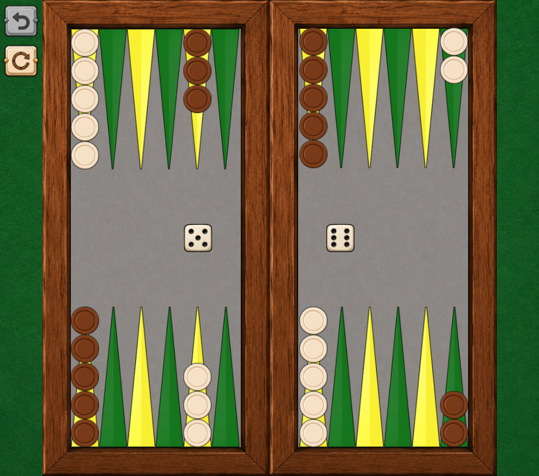

Backgammon Neural AI

My AI. Your next backgammon challenge.
A backgammon game with a neural-network opponent that I trained with self-play.

> **This is a fork.** The game itself (board, rules engine, graphics, animations, undo/reset, original search-based AI) was **not written by me**. It comes from
> [**Backgammon, by Horațiu!**](https://github.com/hmlendea/backgammon-by-horatiu) by [hmlendea](https://github.com/hmlendea), which I copied and built on.
> What I added is the neural AI and the code that plugs it into the game. See [What is mine and what is not](#what-is-mine-and-what-is-not).
Why this project exists
The game is the environment; the AI is the focus. I wanted a real game where my own trained network could be played against, so instead of writing a whole backgammon game from scratch I took Horațiu's open-source one (GPL-3.0) and replaced its computer opponent with mine.
Features
Play as white against the computer (brown)
Standard backgammon rules: 24 points, 15 checkers each, bar, bearing off
Dice, legal-move highlighting, animated moves, undo and reset
Neural AI opponent (value network + 2-ply look-ahead)
Falls back to the original search AI if no network file is found
The neural AI
	
Network	214 inputs → 256 → 128 → 64 → 5 outputs (ReLU hidden layers, sigmoid outputs, ~96,500 parameters)
Inputs	Board seen from the side to move: 196 base features plus 18 hand-made ones (pip counts, contact, blots, primes, ...)
Outputs	P(win), P(win gammon/backgammon), P(win backgammon), P(lose gammon/backgammon), P(lose backgammon)
Training	Self-play (trained outside this repository, as `backgammon_ai_v5`)
Move choice	Depth 2: take the 5 best candidate turns, try all 21 opponent rolls, assume the opponent answers with the reply that is worst for the AI, average over the rolls
Value used	Cubeless money equity
More detail: NEURAL_AI.md (written in Persian).
The AI runs on a worker thread, so the window never freezes while it thinks. If the network file is missing or broken, or the game rejects a planned move, the original search AI plays instead, so the game can't get stuck.
What is mine and what is not
From the original project (not mine):
Game rules engine (`Table`, `GameManager`), entities, undo snapshots
All graphics, assets, screens and animations (MonoGame + NuciXNA)
The original search-based AI (`GameLogic/AI/Search`, `GameLogic/AI/Evaluation`)
CI workflow, `release.sh`, `.desktop` file, `LICENSE`
`ARCHITECTURE.md` — still the original document; it describes the original game and does not cover the neural AI
Added by me:
Path	What it is
`BackgammonByHoratiu/GameLogic/AI/Neural/`	Network loader, feature encoder, rules for look-ahead, move policy and the planner that connects it to the game
`BackgammonByHoratiu/GameLogic/AI/BackgammonAi.cs`	Modified: uses the neural planner when available, with fallback to the original search
`BackgammonByHoratiu/Ai/net.bgnn`	The trained network, in the game's own format
`tools/export_weights.py`	Converts a trained `.npz` into `net.bgnn`
`tools/make_golden.py`	Builds test fixtures from the Python AI
`BackgammonByHoratiu.UnitTests/GameLogic/AI/Neural/` and `Fixtures/neural/`	Tests proving the C# AI gives the same results as the Python one
`NEURAL_AI.md`	Notes on the neural AI (Persian)
The GUI, `Table.cs` and the game rules are unchanged.
Run it
Requirements: .NET 10 SDK, MonoGame content tools (`dotnet-mgcb`) and TrueType fonts on Linux (`fonts-freefont-ttf`).
```bash
dotnet build
dotnet run --project BackgammonByHoratiu
dotnet test
```
The network `Ai/net.bgnn` is copied next to the executable automatically. To use a different network:
```bash
# convert your own trained weights
python tools/export_weights.py path/to/models/latest.npz BackgammonByHoratiu/Ai/net.bgnn

# or point the game to a file elsewhere
export BACKGAMMON_AI_NET=/path/to/net.bgnn
```
Search depth and number of candidates can be changed in `NeuralMovePlanner.cs` (`DefaultDepth`, `DefaultTopCandidates`).
Tests
`dotnet test` also runs the neural parity tests: they check that the C# code reproduces the Python AI's features, network outputs, set of legal moves and chosen move (depth 1 and 2) on stored reference positions.
Credits
Game and original AI: Horațiu / hmlendea — backgammon-by-horatiu. Thank you for releasing it as open source.
Neural AI, integration and tools: me.
ChatGPT was used as a development assistance tool.
Flatpak packaging of the original game: FlatHub repository
License
Licensed under the GNU General Public License v3.0 or later, the same license as the original project. See LICENSE. Because this is a derivative work of a GPL-3.0 project, it stays under GPL-3.0 as well.
